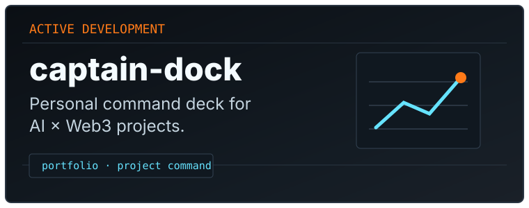

  <picture>
    <source media="(prefers-color-scheme: light)" srcset="assets/banner-light.svg">
    <source media="(prefers-color-scheme: dark)" srcset="assets/banner-dark.svg">
    
  </picture>

 

  

  <h1>CAPTAIN // FANGTIGER</h1>
  
<strong>AI × WEB3 BUILDER</strong>

  
Building intelligent agents, prediction systems and developer infrastructure.

### CURRENT MISSION

Building practical AI × Web3 systems with a control-deck mindset: focused agents, prediction workflows and infrastructure that stays legible under pressure.

  
  
  

### IDENTITY

Winner, Binance AI Competition · Arc Builder · Hong Kong

Site: <a href="https://www.captain-dock.xyz/">captain-dock.xyz</a> 
LinkedIn: <a href="https://www.linkedin.com/in/lao-shugen-0aa058349/">lao-shugen</a> 
X: <a href="https://x.com/mycndota">@mycndota</a>

### ACTIVE DOCK

| Project | Direction |
| --- | --- |
| [ArcPredict](https://github.com/fangTiger/ArcPredict) | Prediction intelligence and agent-driven market research. |
| [captain-dock](https://github.com/fangTiger/captain-dock) | Personal command deck for AI × Web3 projects. |
| [PredictArena](https://github.com/fangTiger/PredictArena) | Forecasting experiments and prediction-system workflows. |
