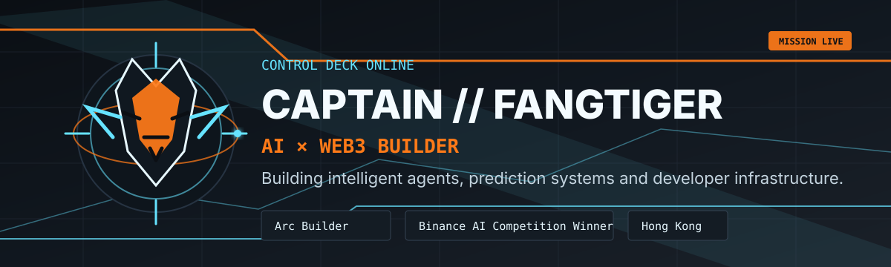
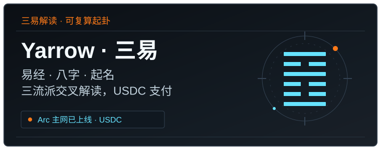
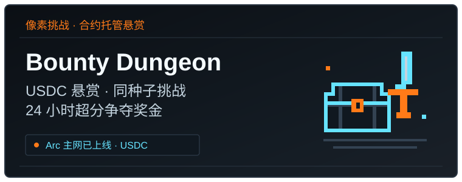
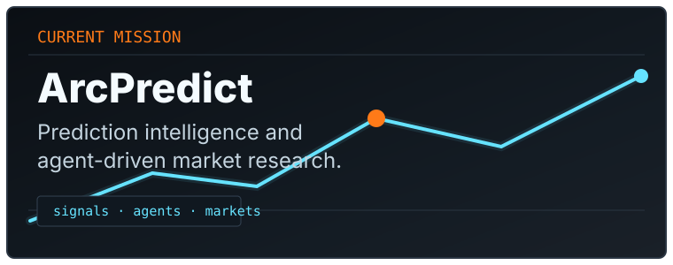
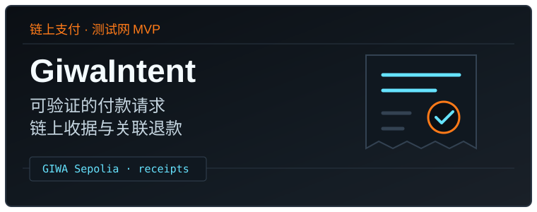
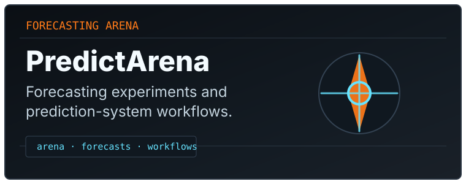
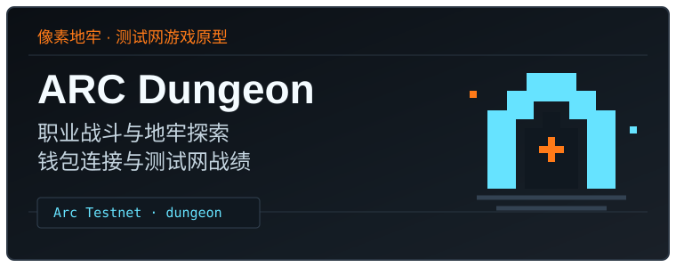
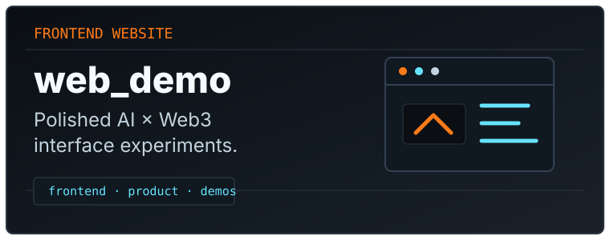
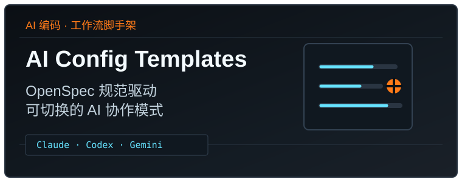

  <picture>
    <source media="(prefers-color-scheme: light)" srcset="assets/banner-light.svg">
    <source media="(prefers-color-scheme: dark)" srcset="assets/banner-dark.svg">
    
  </picture>

 

  

  <h1>CAPTAIN // FANGTIGER</h1>
  
<strong>AI × WEB3 BUILDER</strong>

  
构建智能体、链上预测产品与可复用的 AI 开发工作流。

  
Binance AI 竞赛获奖 · Arc Builder · 香港

  

    <a href="https://www.captain-dock.xyz/">个人网站</a> ·
    <a href="https://github.com/fangTiger?tab=repositories">全部仓库</a> ·
    <a href="https://x.com/mycndota">X / @mycndota</a>
  

### 近期上线 · Arc 主网

两款产品均已在 Arc 主网上线：从三易解读到像素悬赏挑战，以 USDC 连接体验与链上结算。

  
  

| 产品 | 简介 | 体验 / 源码 |
| --- | --- | --- |
| Yarrow · 三易 | 易经、八字与起名解读，三流派交叉解读，支持 USDC 支付；易经以 Arc 区块哈希起卦，可在浏览器复算验证。 | [体验](https://yarrow-six.vercel.app) · [源码](https://github.com/fangTiger/yarrow) |
| Bounty Dungeon | 同一种子的像素 roguelike 挑战：玩家发起 USDC 悬赏，24 小时内首位超分者由合约领取奖金，无人超分到期可退；成绩由服务器重放验证并签名，合约托管结算。 | [体验](https://bounty-dungeon.vercel.app) · [源码](https://github.com/fangTiger/bounty-dungeon) |

### 精选作品

从预测市场、智能体对决、链上付款请求到像素地牢游戏，把 AI × Web3 想法做成可检查的产品原型；同时整理前端模板和 AI 编码工作流，复用开发过程中的经验。

  
  
  

 

  
  
  

| 项目 | 做什么 | 当前阶段 |
| --- | --- | --- |
| [ArcPredict](https://github.com/fangTiger/ArcPredict) | 加密价格与事件预测市场，结合 AI Lens 概率参考、数据源插件和运营工具。 | Arc 测试网原型 |
| [GiwaIntent](https://github.com/fangTiger/giwa-intent) | 将身份、金额、用途与有效期绑定为可验证的付款请求，提供链上收据与关联退款。 | GIWA Sepolia 测试网 MVP；合约已部署，完整实钱包验证待完成 |
| [PredictArena](https://github.com/fangTiger/PredictArena) | 让预测方向相反的智能体对决，以 USDC 链上结算并记录收据与声誉。 | Arc 测试网演示 |
| [ARC Dungeon](https://github.com/fangTiger/Arc-Dungeon) | 像素地牢探索与职业战斗，连接 EVM 钱包并发布测试网战绩；奖励、门票和皮肤为本地模拟资产。 | Arc 测试网游戏原型；真实钱包发布待验证，仓库代码待上传 |
| [web_demo](https://github.com/fangTiger/web_demo) | 面向开发者与 Agent 的静态前端模板库，提供用途分类、可浏览预览与机器可读目录。 | 静态模板库 |
| [ai-config-templates](https://github.com/fangTiger/ai-config-templates) | 将 OpenSpec 规范驱动、Claude / Codex / Gemini 协作与可切换的编码工作流装进项目。 | 可复用开发脚手架 |

### 开发工具与资源

**前端模板：** [web_demo](https://github.com/fangTiger/web_demo) 收录 Web3 产品、营销站、后台、电商与作品集等用途的静态模板。开发者可直接浏览；Agent 可从 [`catalog/templates.json`](https://github.com/fangTiger/web_demo/blob/main/catalog/templates.json) 开始筛选，再检查对应预览与来源。

**AI 编码工作流：** [ai-config-templates](https://github.com/fangTiger/ai-config-templates) 提供全局规则、项目配置和协作模式切换，让规范、实现与验证流程在不同项目中复用。

### 联系我

个人网站：[captain-dock.xyz](https://www.captain-dock.xyz/) 
LinkedIn：[lao-shugen](https://www.linkedin.com/in/lao-shugen-0aa058349/) 
X：[@mycndota](https://x.com/mycndota)
